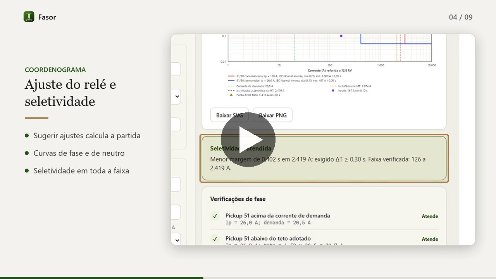
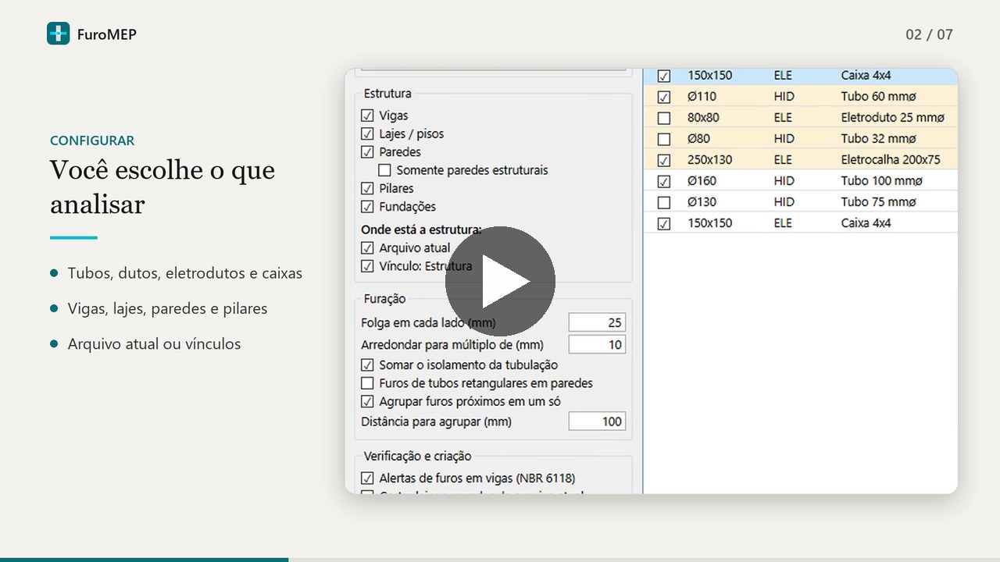
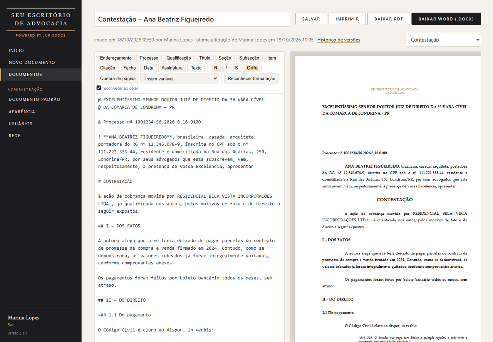
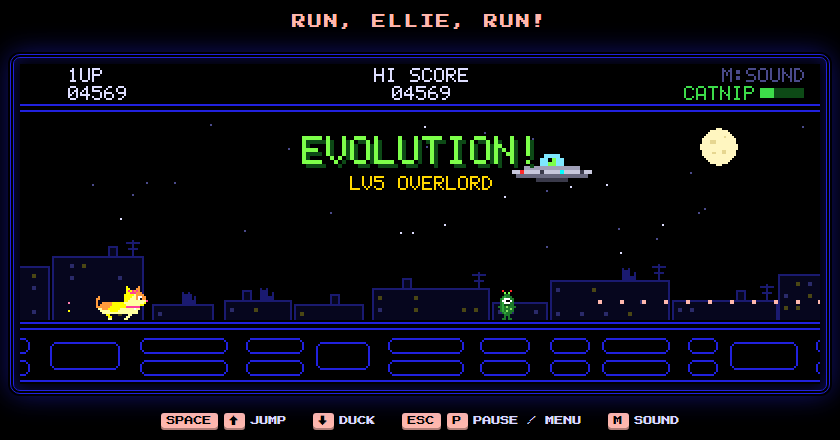

# Portfólio de projetos

Ferramentas que desenvolvi para automatizar tarefas repetitivas em quatro áreas diferentes: engenharia elétrica,
projetos BIM, escritórios de advocacia e aulas particulares. Cada uma nasceu de um problema real de quem usa, tem instalador
próprio e guia de uso, e roda no computador do usuário, sem depender de serviços externos. Fecha a lista um projeto pessoal: um jogo.

> O código-fonte de cada projeto fica em repositório privado. Este repositório reúne a descrição, as telas e
> os vídeos de demonstração. O código pode ser apresentado mediante solicitação.

| | Projeto | O que faz | Tecnologias |
|---|---|---|---|
| ⚡ | **[Fasor](fasor/)** | Estudo de proteção e seletividade em média tensão, do curto-circuito ao memorial de cálculo | Python, pywebview, JavaScript, SQLite FTS5 |
| 🏗️ | **[FuroMEP](furomep/)** | Plug-in do Revit que detecta onde as instalações cruzam a estrutura e cria os furos | C#, .NET 8/10, WPF, Revit API |
| ⚖️ | **[JurisDocs](jurisdocs/)** | Editor de peças jurídicas que formata o texto colado no padrão do escritório | Python, Flask, SQLite, python-docx |
| 🍎 | **[Lousa](lousa/)** | Gestão de aulas particulares: perfil do aluno, agenda, planos, atividades e correção, com IA opcional | Python, Flask, SQLite, IA (Gemini, Ollama, Claude) |
| 🐱 | **[Jump Ellie](jump-ellie/)** | Jogo de corrida infinita com uma gatinha fugindo de pepinos alienígenas, em visual de fliperama | JavaScript, Canvas, Web Audio, Python, pywebview |

## Fasor

Aplicativo desktop para Windows. Recebe a carta de curto-circuito da concessionária, os transformadores e a
demanda, calcula as correntes de curto, sugere os ajustes do relé, desenha o coordenograma e o unifilar,
confere cerca de 20 critérios e gera o memorial de cálculo em Word. → [Detalhes](fasor/)

## FuroMEP

Plug-in para Revit 2025, 2026 e 2027. Compara tubos, dutos, eletrodutos e caixas com vigas, lajes, paredes,
pilares e fundações (no arquivo e em vínculos), dimensiona cada furo, alerta pelas condições da NBR 6118 e
cria os furos como famílias editáveis com etiqueta automática. → [Detalhes](furomep/)

## JurisDocs

Sistema local para escritórios de advocacia. O escritório envia uma vez o seu documento modelo (.docx) e,
a partir daí, o texto cru colado é reconhecido parte a parte (endereçamento, qualificação, título, tópicos,
citações, fecho, assinatura) e sai em Word e PDF com o padrão exato do escritório. → [Detalhes](jurisdocs/)

## Lousa

Sistema local para professores particulares. Reúne o perfil pedagógico e a evolução de cada aluno, a agenda,
o registro das aulas, planos de aula e atividades com correção automática e devolutiva, com saída em PDF e
Word. A IA é opcional (Gemini e Ollama gratuitos, ou Claude) e também é possível colar respostas do ChatGPT,
Claude ou Gemini, que viram plano ou questões. → [Detalhes](lousa/)

## Jump Ellie

Projeto pessoal: o jogo do dinossauro do Chrome com visual de fliperama à moda do Pac-Man. A gatinha Ellie corre
pelos telhados fugindo de pepinos alienígenas que evoluem com a pontuação, a erva-de-gato faz o papel da pílula
de poder e, na derrota, um disco voador a abduz. Pixel art e trilha chiptune feitas no próprio código, e
instalador para Windows. → [Detalhes](jump-ellie/)

---

Todas as telas usam dados de exemplo.
