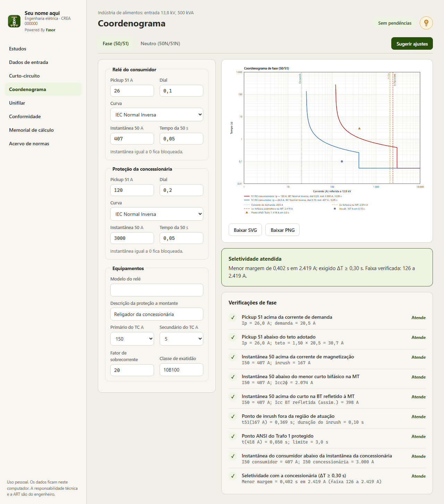
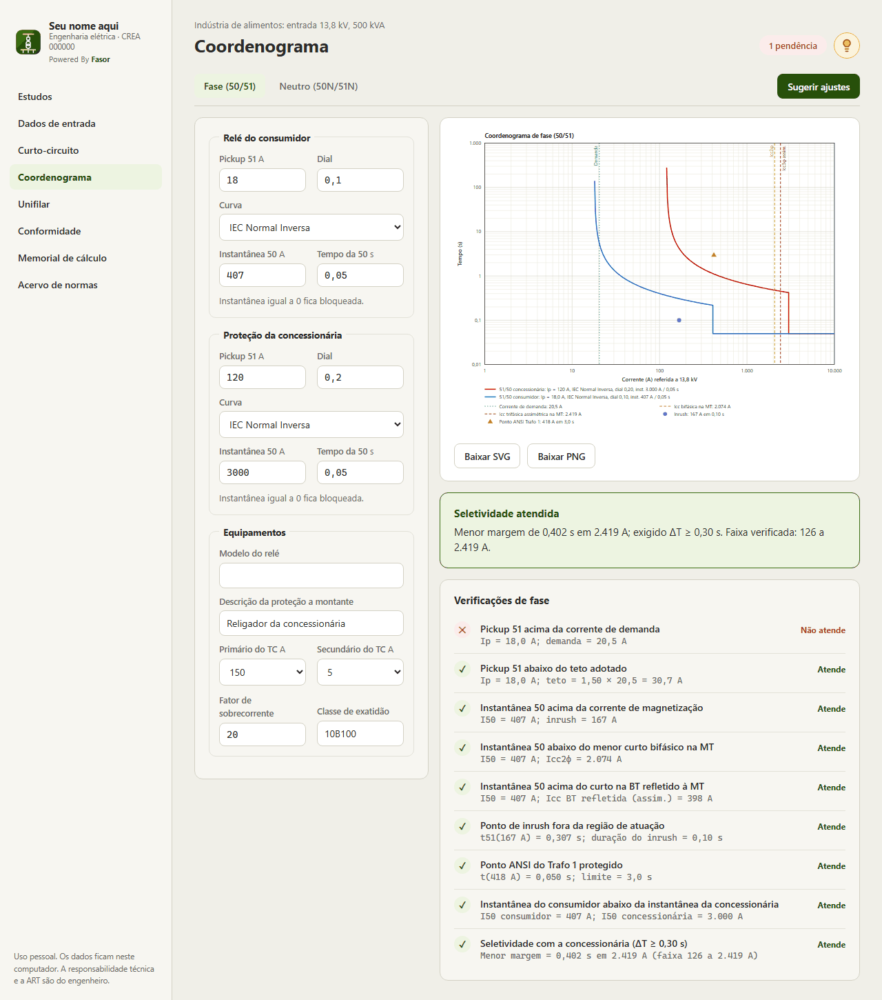
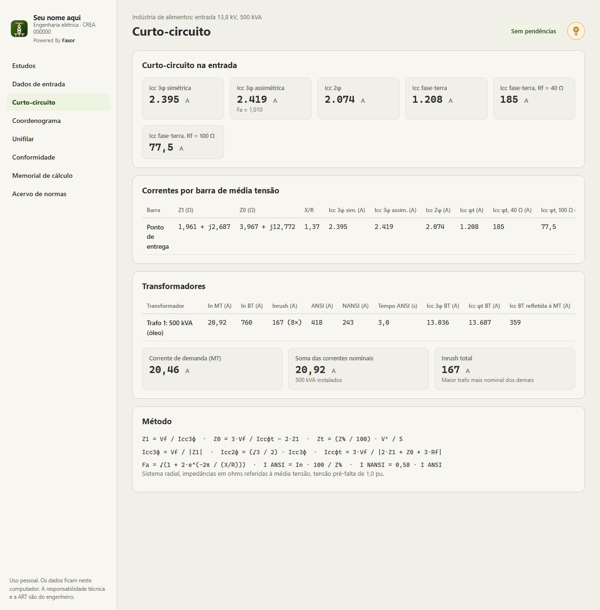
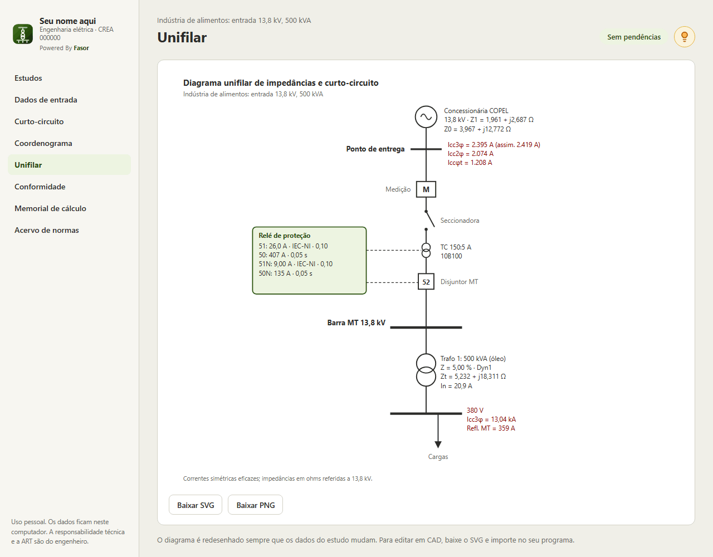
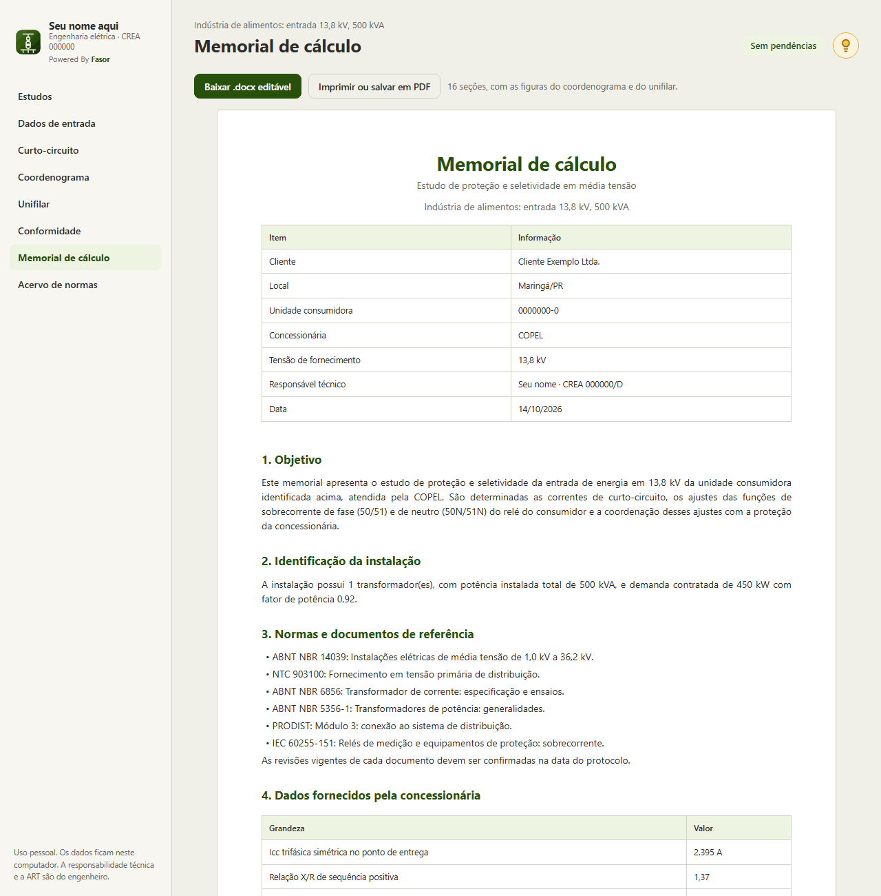
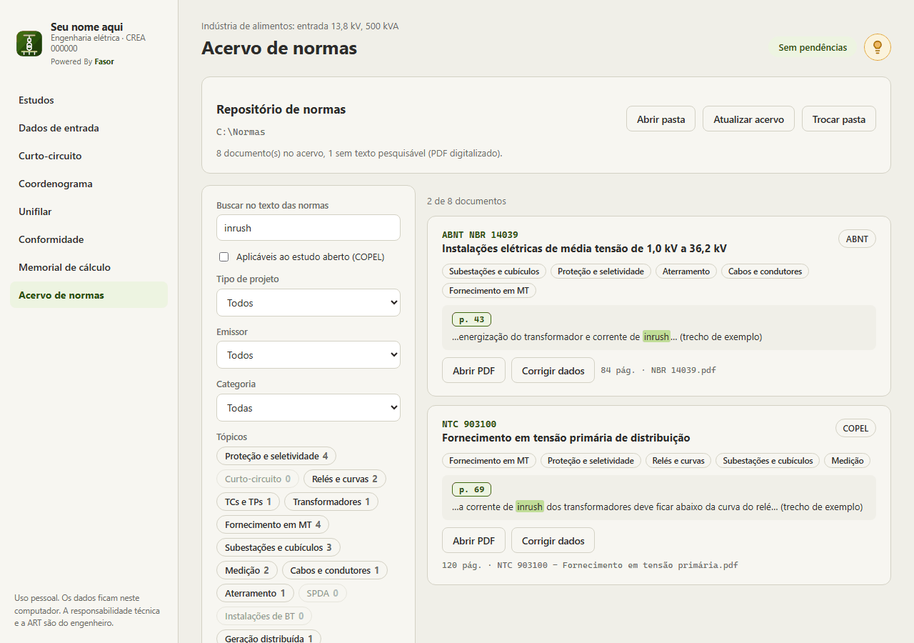

# Fasor

**Estudos de proteção e seletividade em média tensão**

Clique na imagem para ver o vídeo de demonstração (1min15, sem áudio).

## O problema

Um estudo de proteção da entrada de energia em média tensão costuma ficar espalhado: planilhas de
curto-circuito, o coordenograma feito em outro programa, normas em PDF soltas em pastas e o memorial de
cálculo digitado no fim. Cada alteração de ajuste obriga a refazer tudo à mão.

## A solução

O Fasor reúne o estudo inteiro em um aplicativo para Windows. Cada campo alterado recalcula todas as telas
na hora, e o memorial sai pronto para protocolar.

| Área | O que faz |
|---|---|
| Estudos | Vários estudos, com salvamento automático, duplicação para comparar alternativas e exportação em `.json` |
| Dados de entrada | Carta de curto da concessionária (11,4 a 34,5 kV), demanda, ramal de MT, um ou mais transformadores, gerador em paralelo e critérios do estudo |
| Curto-circuito | Correntes trifásica (simétrica e assimétrica), bifásica e fase-terra com resistência de falta, em cada barra e no secundário de cada transformador; inrush, pontos ANSI e NANSI |
| Ajuste do relé | Funções 50/51 e 50N/51N com curvas IEC e IEEE; **Sugerir ajustes** calcula os valores de partida e escolhe o TC |
| Coordenograma | Gráfico tempo × corrente de fase e de neutro, exportável em SVG e PNG |
| Seletividade | Confere a margem entre as curvas em toda a faixa de corrente, não só em um ponto |
| Conformidade | Cerca de 20 verificações de fase, neutro, TC e geração, cada uma com o valor calculado e o limite |
| Unifilar | Diagrama com impedâncias, correntes e ajustes, redesenhado a cada alteração |
| Memorial de cálculo | 16 seções com fórmulas, tabelas e figuras, em Word (.docx) editável ou PDF |
| Acervo de normas | Indexa uma pasta de PDFs, identifica código, emissor e assunto, busca no texto de todas e abre o PDF na página encontrada |

## Telas

| | |
|---|---|
|  |  |
| **Coordenograma:** ajustes, curvas e veredito de seletividade | **Pendência:** um ajuste fora do critério aparece em destaque |
|  |  |
| **Curto-circuito:** correntes por barra e por transformador | **Unifilar:** gerado automaticamente |
|  |  |
| **Memorial de cálculo** em Word ou PDF | **Acervo de normas** com busca no texto |

## Como foi construído

- **Interface:** HTML, CSS e JavaScript puros, sem etapa de build, em janela desktop com **pywebview**. Uma ponte
  Python ↔ JavaScript cuida de arquivos, diálogos e do banco de normas.
- **Motor de cálculo:** em JavaScript (`calc.js`), separado da interface, com uma página de testes que confere
  os resultados contra valores de referência.
- **Gráficos:** coordenograma em escala log-log e unifilar desenhados em SVG pelo próprio programa.
- **Memorial:** gerado em `.docx` diretamente no programa, com fórmulas, tabelas e as figuras do estudo.
- **Acervo de normas:** leitura dos PDFs com **pypdf** e busca textual com **SQLite FTS5**.
- **Distribuição:** **PyInstaller** e **Inno Setup** geram um instalador que não exige administrador.
- **Licença:** 14 dias de teste e ativação offline por chave assinada com **RSA-2048**, emitida por um gerador
  de licenças próprio.

Cerca de 2.700 linhas, entre Python e JavaScript.

> O Fasor faz os cálculos e as conferências; a escolha dos critérios, a conferência com a norma vigente da
> concessionária e a ART continuam com o responsável técnico.

Telas com estudos e dados de exemplo. Código-fonte em repositório privado.
