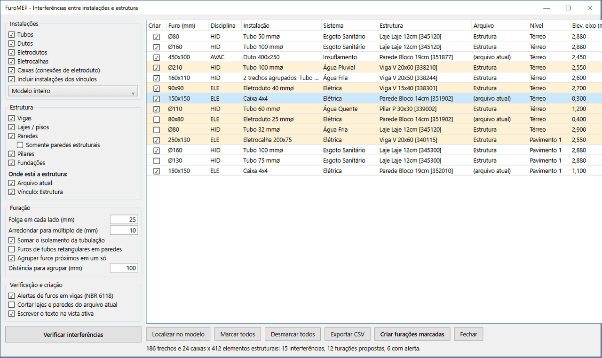
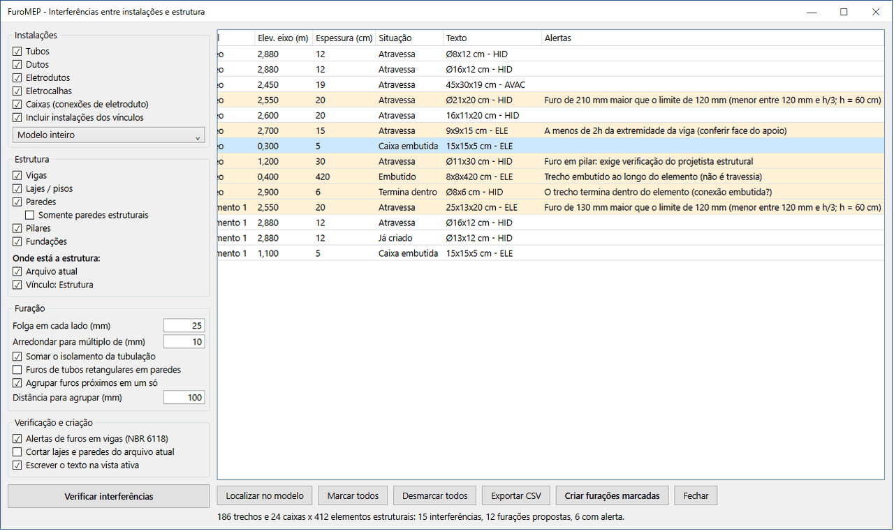
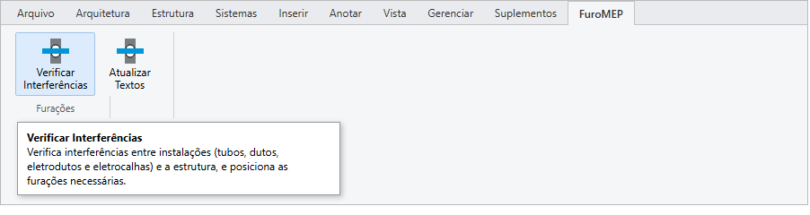
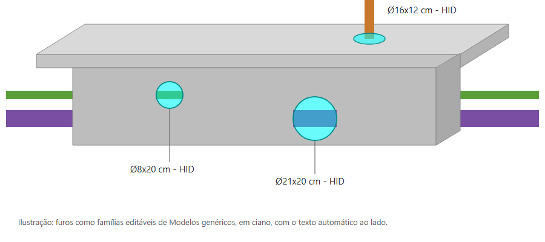

# FuroMEP

**Furações entre instalações e estrutura, direto no Revit (2025, 2026 e 2027)**

Clique na imagem para ver o vídeo de demonstração (1min, sem áudio).

## O problema

Na compatibilização de projetos, marcar os furos onde tubos, dutos e eletrodutos atravessam vigas, lajes e
paredes é uma tarefa manual, demorada e sujeita a erro. Um furo esquecido ou mal posicionado vira problema na
obra.

## A solução

O FuroMEP é um plug-in que encontra cada travessia, propõe o furo já dimensionado, avisa quando ele precisa da
atenção do projetista estrutural e cria todos os furos de uma vez. Testado no Revit.

| Área | O que faz |
|---|---|
| Instalações | Tubos, dutos, eletrodutos, eletrocalhas e caixas de passagem, do arquivo atual e dos vínculos; modelo inteiro, vista ativa ou seleção |
| Estrutura | Vigas, lajes, paredes, pilares e fundações, no arquivo atual ou em vínculos RVT/IFC |
| Detecção | Cada trecho que atravessa um elemento, com a espessura atravessada, o nível e a elevação do eixo |
| Classificação | Separa travessias reais de trechos embutidos ao longo do elemento e dos que terminam dentro dele |
| Dimensionamento | Dimensão externa (com isolamento) + folga, arredondada; elétrica retangular, hidráulica circular, caixas viram nicho |
| Agrupamento | Instalações paralelas e próximas no mesmo elemento viram um único furo |
| Alertas | Pré-verificação de furos em vigas pelas condições da NBR 6118; pilares, fundações e travessias oblíquas sinalizados |
| Revisão | Tabela de interferências, localização no modelo com duplo clique e exportação para planilha (CSV) |
| Criação | Famílias editáveis em ciano, sem duplicar furos existentes, tudo em uma única transação (um Ctrl+Z desfaz) |
| Texto automático | Medidas e disciplina de cada furo (ex.: `20x15x19 cm - ELE`, `Ø16x12 cm - HID`), em parâmetro e na vista |

## Telas

| | |
|---|---|
|  |  |
| **Janela principal:** opções à esquerda, furos propostos à direita | **Alertas:** valor medido e limite de cada furo |
|  |  |
| **Aba própria** na faixa de opções do Revit | **Furos editáveis** com o texto automático (ilustração) |

## Como foi construído

- **C# e WPF**, com a **Revit API** (pacotes `Nice3point.Revit.Api`), compilado para **.NET 8** (Revit 2025 e
  2026) e **.NET 10** (Revit 2027) a partir do mesmo código.
- **Detecção geométrica:** interseção das curvas das instalações com os sólidos da estrutura, inclusive em
  vínculos, com transformação de coordenadas entre os arquivos.
- **Famílias geradas por código:** as quatro famílias de furo (retangular e circular, horizontal e vertical)
  são desenhadas pela API a partir do modelo de família do Revit e passam por um autoteste de flexão das
  medidas antes de serem usadas.
- **Regras de norma:** conferência dos furos em vigas pelas condições de dispensa da NBR 6118 (itens 13.2.5.1
  e 21.3.3), com a altura e a largura da viga medidas na geometria.
- **Distribuição:** instalador por script, sem administrador, para as três versões do Revit.
- **Licença:** 14 dias de teste e ativação offline por chave assinada com **RSA-2048**.

Cerca de 2.800 linhas de C#.

> Os alertas ajudam a priorizar a conversa com o projetista estrutural, mas não substituem a verificação
> dele.

Janela reproduzida com projeto e números de exemplo. Código-fonte em repositório privado.
