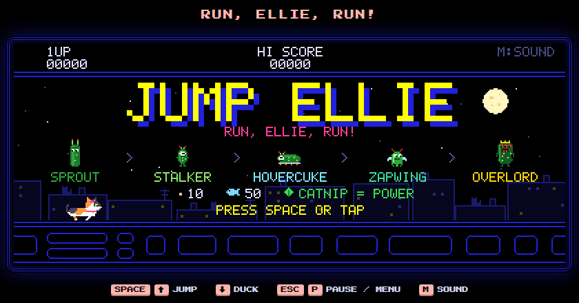
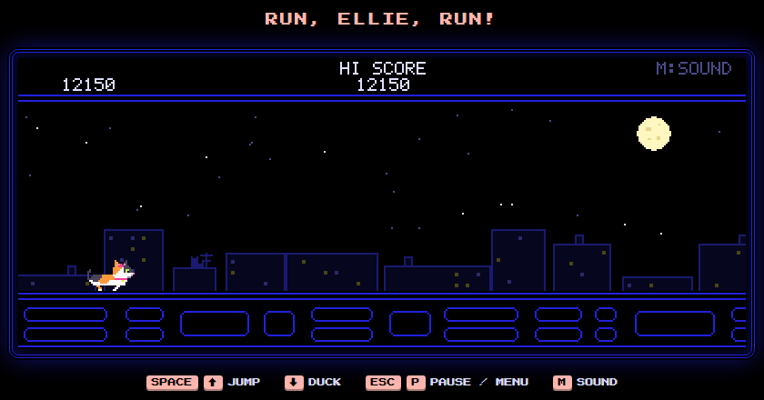
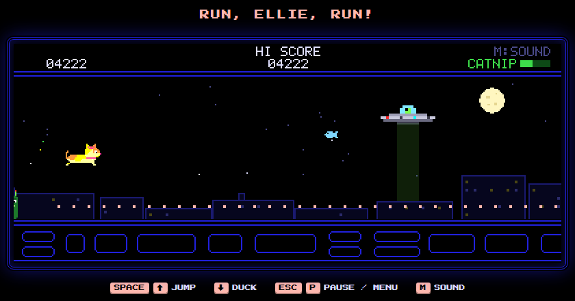
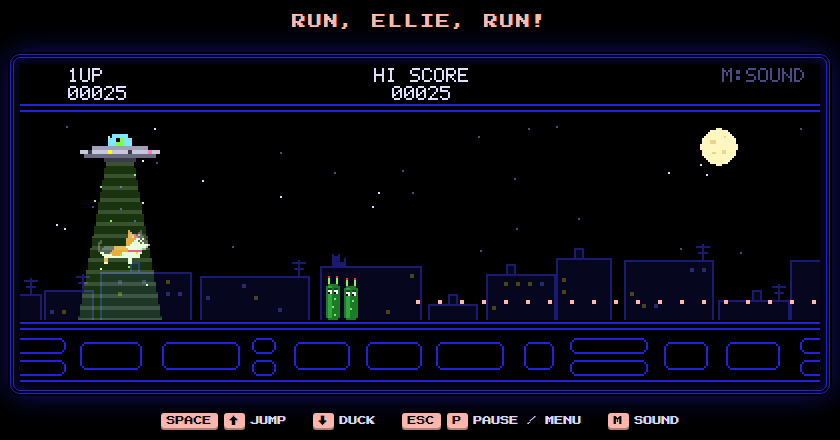
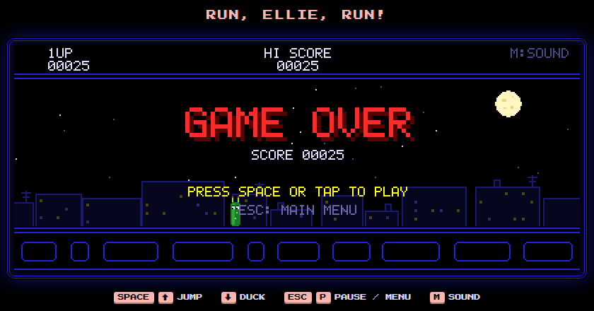

# Jump Ellie

**RUN, ELLIE, RUN! Um jogo de corrida infinita com uma gatinha tricolor fugindo de pepinos alienígenas**

## A ideia

Um projeto pessoal: um jogo de corrida infinita com a Ellie, uma gatinha tricolor de laço e coleira rosa,
correndo pelos telhados da cidade à noite. O visual é de fliperama retrô, com neon azul, pixel art e letras
de arcade, e a erva-de-gato dá poderes à Ellie. O jogo é todo em inglês e instala no Windows como
qualquer outro aplicativo.

## Como se joga

| | |
|---|---|
| Controles | `Espaço` ou `↑` pula, `↓` abaixa, `Esc` ou `P` abre o menu de pausa, `M` liga o som; na tela de toque, basta tocar |
| Pontos | Pontinhos valem 10 e peixinhos valem 50; o recorde fica salvo no computador |
| Poder | A erva-de-gato deixa a Ellie brilhando por alguns segundos: ela esmaga os pepinos no chão e come os voadores, que valem 200, 400, 800 e 1600 em sequência |
| Vilões | Pepinos alienígenas que evoluem com a pontuação: SPROUT, STALKER (400), HOVERCUKE (1200), ZAPWING (2500) e OVERLORD (4500) |
| Derrota | Um disco voador desce e abduz a Ellie com o raio trator antes do GAME OVER |

## Telas

| | |
|---|---|
|  |  |
| **Corrida** pelos telhados, com um ZAPWING à frente | **EVOLUTION!** O pepino chegou ao nível OVERLORD |
|  |  |
| **Erva-de-gato:** a Ellie brilha e os pepinos viram presa | **Abdução** pelo disco voador, que também é o ícone do app |
|  | |
| **GAME OVER**, com a pontuação e a volta ao menu | |

## Como foi construído

- **Um único arquivo HTML** que funciona offline: **Canvas** e **JavaScript** puro, sem bibliotecas. Todos os
  sprites (a Ellie, os cinco pepinos, o disco voador e a cidade) são pixel art desenhada no próprio código, e a
  fonte Press Start 2P vai embutida.
- **Trilha sonora chiptune original**, sintetizada na hora pela **Web Audio API**: baixo, acordes e melodia
  sobre a harmonia de "Run" (BTS, 2015), além dos efeitos de pulo, "waka-waka" dos pontinhos, sirene do poder e a abdução com raio trator e miado.
- **App para Windows:** **Python + pywebview (WebView2)** abre o jogo numa janela própria, sem cara de navegador,
  e um servidor local numa porta fixa garante que o recorde continue salvo. O instalador cria os atalhos e aparece
  em Configurações > Aplicativos para desinstalar. Tudo empacotado com **PyInstaller**, e o ícone é gerado em
  **Pillow** a partir dos sprites do jogo.
- **Testes:** um modo de demonstração em que um robô joga sozinho e congela instantes específicos (poder,
  abdução, game over). Foi assim que estas telas foram capturadas, no Edge sem janela.

Cerca de 1.100 linhas de JavaScript e 340 de Python.

Código-fonte em repositório privado.
