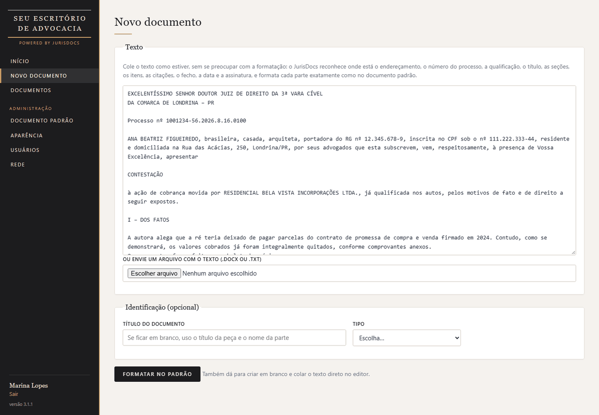
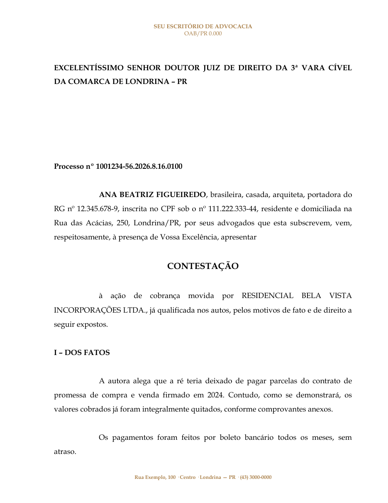
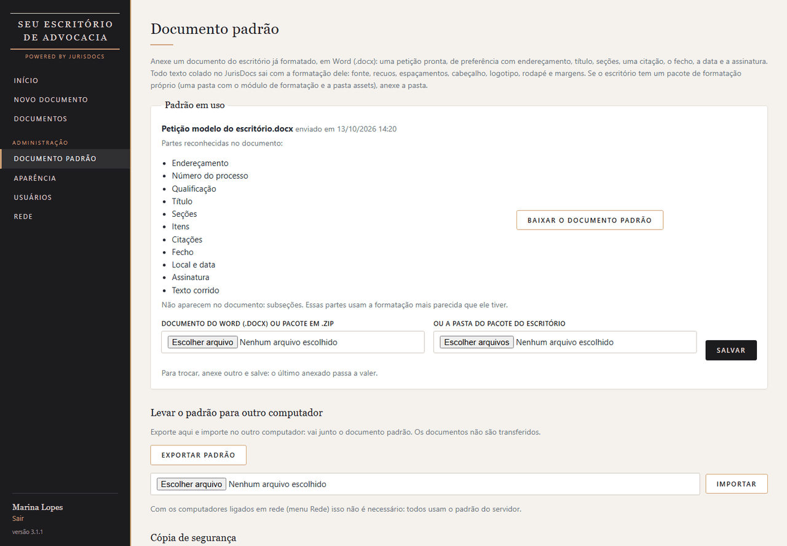
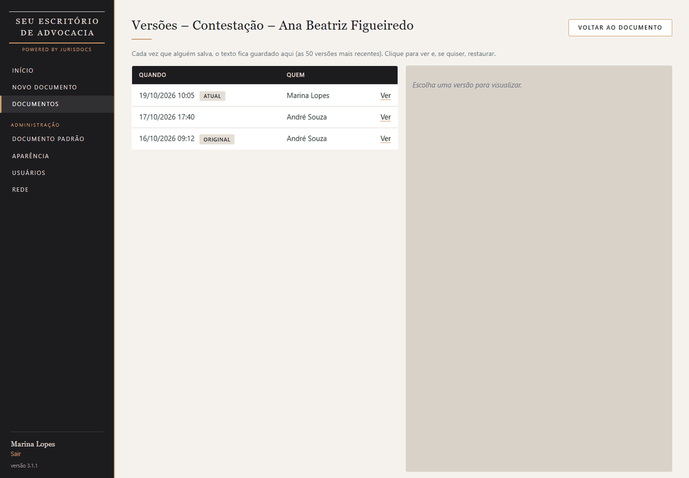
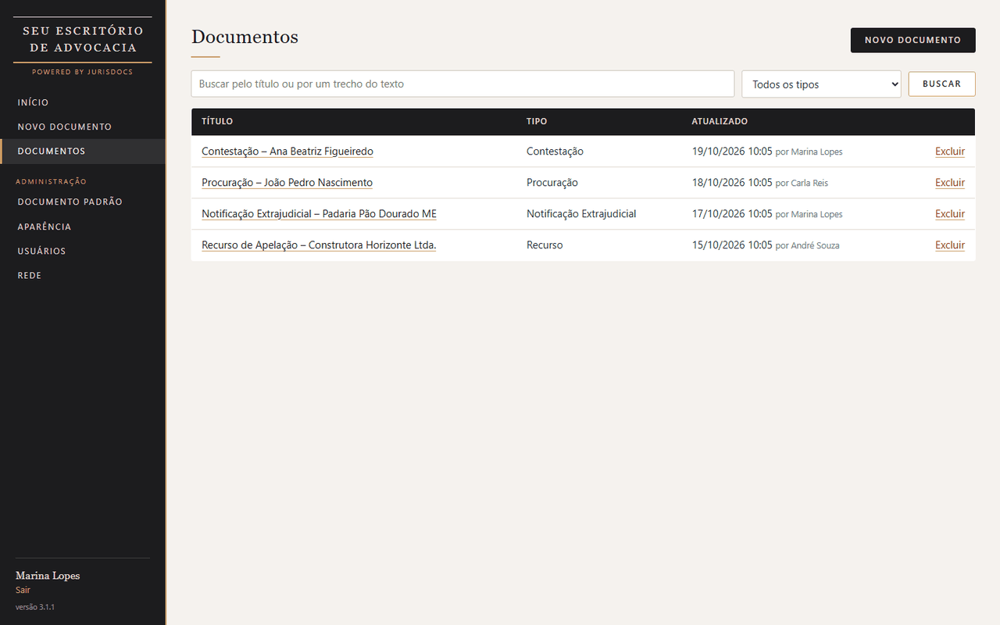
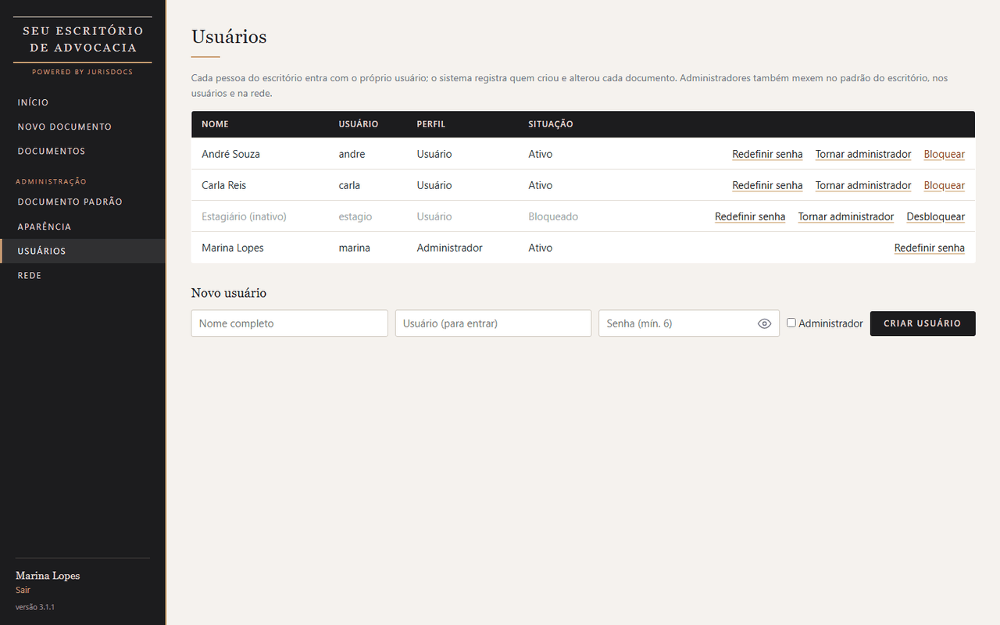

# JurisDocs

**Peças jurídicas no padrão do escritório, sem perder tempo formatando**

## O problema

Em um escritório de advocacia, o texto da peça fica pronto e ainda falta a formatação: fonte, recuos,
espaçamento, cabeçalho, numeração dos tópicos, citações de lei e jurisprudência. O trabalho se repete em toda
peça, e cada pessoa formata de um jeito.

## A solução

O escritório envia uma única vez o seu documento modelo (.docx). Daí em diante, basta colar o texto cru: o
JurisDocs reconhece cada parte e gera o documento com o padrão exato do escritório.

| Área | O que faz |
|---|---|
| Documento padrão | Lê o .docx modelo e guarda fonte, tamanhos, espaçamento, recuos, margens, cabeçalho com logotipo e rodapé |
| Reconhecimento | Classifica o texto colado em endereçamento, processo, qualificação, título, seção, subseção, item, citação, fecho, data e assinatura |
| Editor | Marcação simples por prefixos, botões para cada papel, grifo, variáveis e prévia lado a lado |
| Geração | Documento em Word (.docx) clonando os parágrafos do modelo, e em PDF |
| Versões | Histórico de versões de cada documento, com autor e data |
| Usuários | Login por usuário (administrador e comum), limite de tentativas e recuperação de senha por código |
| Rede | Funciona em um computador só ou em rede local (servidor e clientes) |
| Aparência | Nome, logo e cores de cada instalação |

## Telas

| | |
|---|---|
|  |  |
| **Novo documento:** o texto é colado como estiver | **Resultado no Word**, no padrão do escritório |
|  |  |
| **Documento padrão:** anexar o modelo e salvar | **Histórico de versões** |
|  |  |
| **Documentos** do escritório | **Usuários** e permissões |

## Como foi construído

- **Python + Flask**, servido por **waitress**, com **SQLite**. Abre em janela própria (Edge ou Chrome em modo
  aplicativo), então o usuário não percebe que é uma aplicação web.
- **Reconhecimento de estrutura:** classificador por regras que analisa cada linha (caixa alta, posição no
  documento, padrões como número de processo, "Excelentíssimo", citações e datas) e marca o papel de cada
  parágrafo.
- **Geração de Word fiel ao modelo:** em vez de recriar estilos, o programa abre o próprio .docx do escritório,
  apaga o corpo e clona o parágrafo de mesmo papel para cada trecho (**python-docx**). Cabeçalho, rodapé e
  estilos ficam idênticos.
- **Leitura do modelo:** extração de fonte, recuos, margens, cabeçalho e rodapé de um .docx qualquer.
- **Segurança:** senhas com hash, limite de tentativas por usuário e por computador, código de recuperação
  guardado só como hash.
- **Distribuição:** **PyInstaller** e **Inno Setup**, instalação por usuário, sem administrador.

Cerca de 4.100 linhas de Python, mais templates HTML e JavaScript.

Telas com escritório, pessoas e processos fictícios. Código-fonte em repositório privado.
