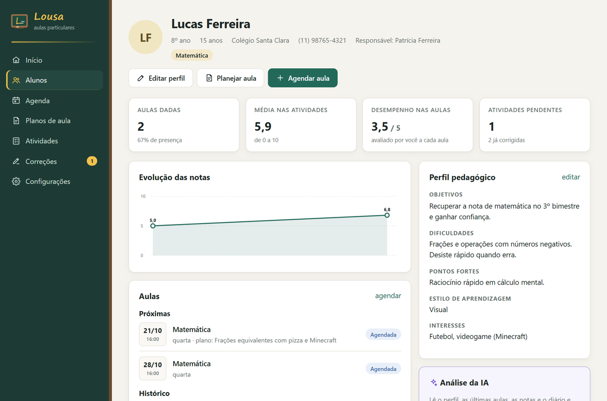
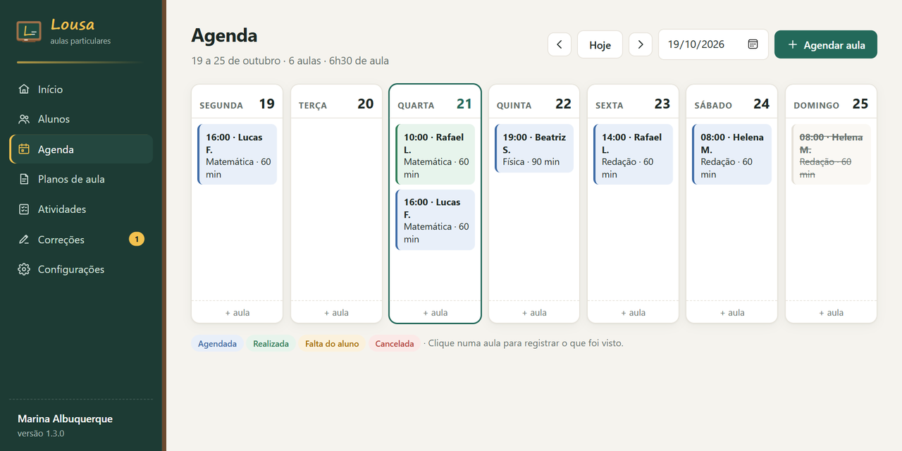
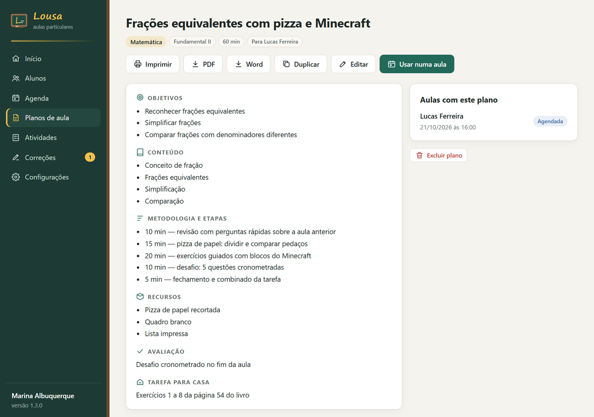
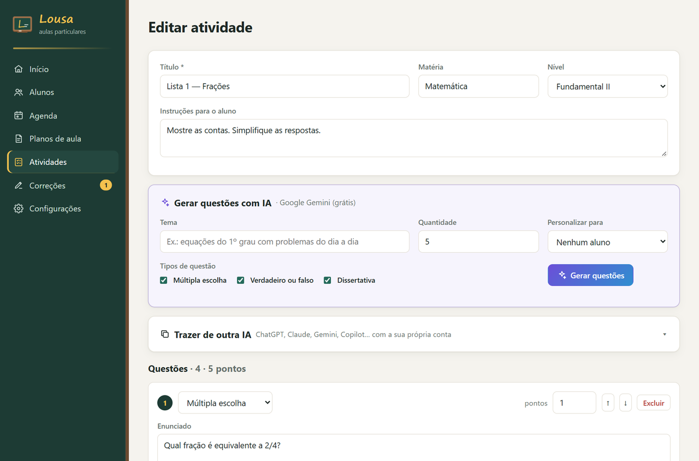
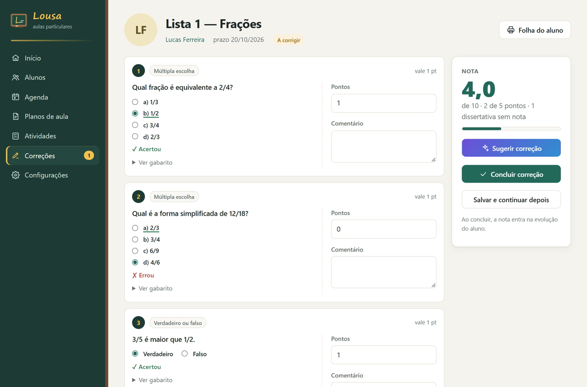
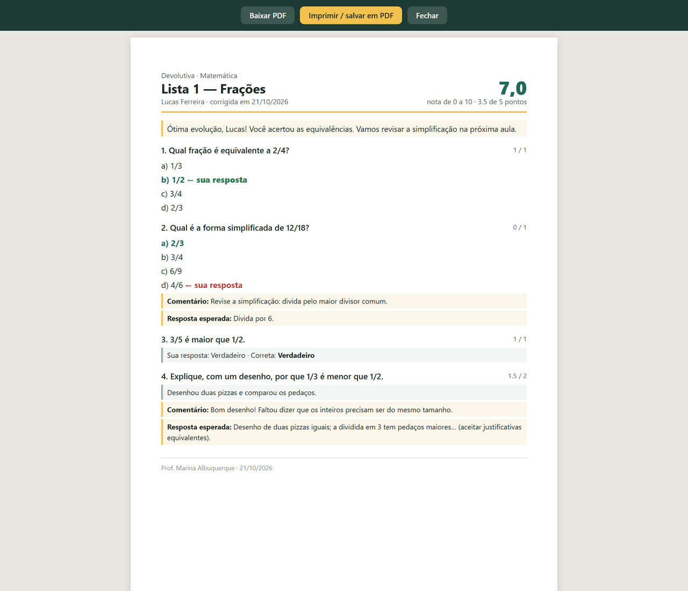
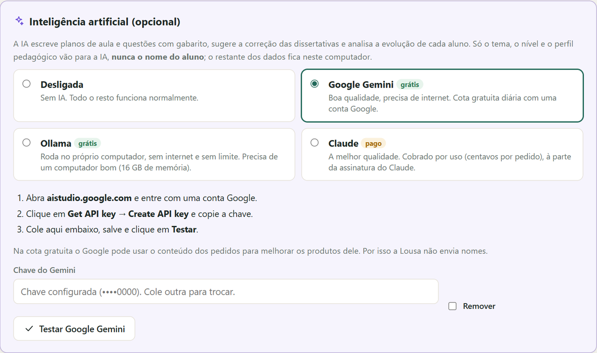
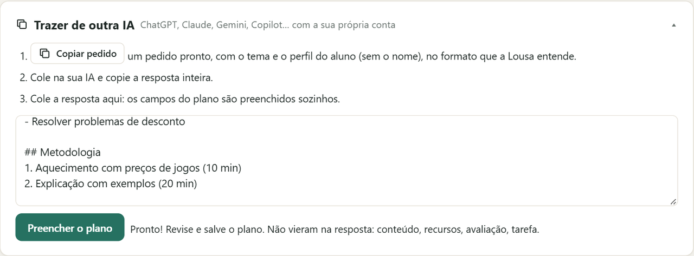

# Lousa

**A aula particular organizada em um só lugar: do perfil do aluno à correção da atividade**

## O problema

O professor particular cuida sozinho de tudo: agenda de vários alunos, o que foi visto em cada aula, planos,
listas de exercícios, correção e o acompanhamento da evolução de cada um. Normalmente isso fica espalhado entre
caderno, WhatsApp, Word e a memória, e a preparação toma mais tempo do que a própria aula.

## A solução

Um aplicativo instalado no computador do professor, inspirado em plataformas como Teachy e Aula Marcada, mas sem
mensalidade e com os dados guardados só ali. A inteligência artificial é opcional e há opções gratuitas.

| Área | O que faz |
|---|---|
| Alunos | Perfil pedagógico (objetivos, dificuldades, pontos fortes, estilo de aprendizagem, interesses) |
| Evolução | Gráfico das notas, média, presença, desempenho em cada aula e diário de anotações |
| Agenda | Semana com as aulas, aulas repetidas toda semana, plano de aula ligado a cada aula |
| Registro da aula | Se aconteceu, conteúdo trabalhado, observações e desempenho em estrelas |
| Planos de aula | Objetivos, conteúdo, etapas, recursos, avaliação e tarefa; duplicar e reaproveitar |
| Atividades | Múltipla escolha, verdadeiro ou falso e dissertativas, com gabarito e pontos |
| Correção | Objetivas corrigidas sozinhas, nota de 0 a 10 calculada na hora e devolutiva para o aluno |
| PDF e Word | Planos, folhas do aluno, gabaritos e devolutivas para imprimir ou enviar |
| IA opcional | Gera planos e questões, sugere a correção das dissertativas e analisa a evolução do aluno, com Gemini (grátis), Ollama (grátis, local) ou Claude |
| Trazer de outra IA | Para quem já usa ChatGPT, Claude ou Gemini com a própria conta: prepara o pedido e preenche o plano ou as questões com a resposta colada |

## Telas

| | |
|---|---|
|  |  |
| **Ficha do aluno:** evolução das notas, aulas e perfil | **Agenda** da semana |
|  |  |
| **Plano de aula**, com impressão, PDF e Word | **Editor de questões** com gabarito |
|  |  |
| **Correção:** objetivas automáticas e nota ao vivo | **Devolutiva** para o aluno, em PDF |
|  |  |
| **IA opcional:** gratuita ou paga | **Trazer de outra IA:** a resposta colada vira plano |

## Como foi construído

- **Python + Flask**, servido por **waitress**, com **SQLite**. Abre em janela própria (Edge ou Chrome em modo
  aplicativo), sem parecer uma aplicação web.
- **IA com vários provedores:** a mesma função pede ao modelo uma resposta em JSON com esquema definido
  (**Pydantic**) e valida o resultado. Gemini pela API REST com esquema de resposta (escolhendo sozinho o modelo
  gratuito mais novo), Ollama local com saída estruturada e Claude pelo SDK oficial. O nome do aluno nunca é
  enviado: só o perfil pedagógico.
- **Reconhecimento de texto colado:** analisador por regras, sem IA, que entende markdown, tabelas, títulos de
  seção, questões numeradas, alternativas, verdadeiro ou falso e gabaritos no fim ou junto de cada questão.
- **Exportação:** Word com **python-docx** (linhas de resposta desenhadas com tabulações) e PDF gerado pelo
  próprio Edge, sem janela, a partir da folha de impressão.
- **Testes:** demonstração com dados fictícios que abre todas as telas, servidores falsos que imitam as APIs de
  IA e testes no navegador com **Playwright**.
- **Distribuição:** **PyInstaller** e **Inno Setup**, instalação por usuário, sem administrador.

Cerca de 2.000 linhas de Python, mais templates HTML, CSS e JavaScript.

Telas com professora e alunos fictícios. Código-fonte em repositório privado.
